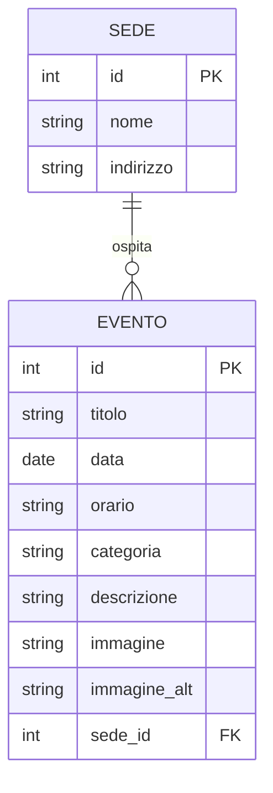

# Scheda dati — Segnale

## 1. Entità

Il progetto utilizza due entità:
- **Evento**: rappresenta un appuntamento del festival.
- **Sede**: rappresenta un luogo in cui si svolgono gli eventi.

## 2. Campi

### Evento (`eventi.json`)

| Campo | Tipo | Esempio |
|---|---|---|
| `id` | Numero | `1` |
| `titolo` | Stringa | `"Lettere in movimento"` |
| `data` | Data (YYYY-MM-DD) | `"2026-06-12"` |
| `orario` | Stringa (HH:MM) | `"10:00"` |
| `categoria` | Stringa | `"Incontro"` |
| `descrizione` | Stringa | `"Un incontro su tipografia..."` |
| `immagine` | Stringa | `"assets/lettere-in-movimento.svg"` |
| `immagine_alt` | Stringa | `"Lettere geometriche disposte su una griglia"` |
| `sede_id` | Numero | `1` |

### Sede (`sedi.json`)

| Campo | Tipo | Esempio |
|---|---|---|
| `id` | Numero | `1` |
| `nome` | Stringa | `"Officina Nord — Sede centrale"` |
| `indirizzo` | Stringa | `"Corso Duca degli Abruzzi 24, Torino"` |

## 3. Chiavi primarie

Entrambe le entità hanno una chiave primaria `id` numerica, univoca all'interno della rispettiva entità e stabile nel tempo.

## 4. Relazione tra le entità

Una sede può ospitare più eventi, mentre ogni evento si svolge in una sola sede.

Il campo `Evento.sede_id` è una chiave esterna che fa riferimento a `Sede.id`.

## 5. Quantità dei dati

- **Eventi:** 6
- **Sedi:** 3

## 6. Aggiornamento dei dati

I dati vengono aggiornati modificando i file `eventi.json` e `sedi.json` nella repository del progetto. Dopo le modifiche, i file vengono pubblicati insieme al sito tramite il repository.

## 7. Che cosa mostra la pagina

La pagina Programma mostra le schede dei sei eventi, con titolo, data, orario, categoria, descrizione e immagine. Ogni evento è collegato alla propria sede tramite `sede_id`, così da visualizzarne il nome e l'indirizzo recuperati da `sedi.json`.

La pagina Info e luoghi presenta le tre sedi del festival, con i relativi indirizzi e la mappa.

## 8. Schema della relazione Evento–Sede

